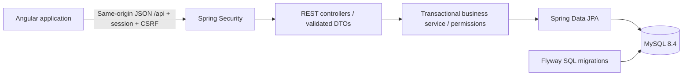

# SupportHub architecture

## Scope
An independently runnable helpdesk portfolio project matching the first project in the supplied resume: Java 21, Spring Boot 3.5, Maven, Angular 21, TypeScript, Spring Data JPA, MySQL and JUnit. Synthetic demonstration data only. No email delivery, file uploads or external integrations are claimed.

## Components

The production Angular build is served by Spring Boot. Development uses the Angular proxy. Local demo uses file-backed H2 with the same migration; MySQL is the deployment database. Cookies are HttpOnly for sessions, SameSite=Lax, and Secure in the production profile. Angular sends the XSRF header. Authentication uses BCrypt and server-side sessions; no tokens are stored in browser storage. Horizontal scaling requires a shared session store.

## Data model
- Account: id, display name, unique normalized email, password hash, role, enabled.
- Ticket: id, title, description, category, priority, status, requester, optional assignee, timestamps, optimistic version.
- Comment: ticket, author, text, timestamp.
- Activity: ticket, actor, action, timestamp. Append-only through the API.

Ticket writes lock their row, compare the version supplied by the client and return 409 on stale changes. Comments and activities are persisted in the same transaction as their operation. Foreign keys preserve history. No hard-delete endpoint is provided.

## Authorization
| Operation | Requester | Agent | Admin |
|---|---|---|---|
| Create ticket | Yes | Yes | Yes |
| Read / comment | Own only | All | All |
| Assign / change priority / status | No | Yes | Yes |
| Manage roles / disable accounts | No | No | Yes |

Public registration always creates REQUESTER. Current enabled status and role are read from the database for every business operation. Admins cannot modify their own role/enabled state, preserving an active administrator. Disabled or requester accounts cannot be assigned. Demoting/disabling staff with active assigned tickets is rejected until tickets are reassigned.

## Ticket lifecycle
OPEN -> IN_PROGRESS -> WAITING -> IN_PROGRESS; OPEN/IN_PROGRESS/WAITING -> RESOLVED -> CLOSED. RESOLVED and CLOSED can reopen to OPEN. IN_PROGRESS requires an active assignee. CLOSED tickets cannot receive comments until reopened. Ticket priority is LOW, MEDIUM, HIGH or URGENT; category is GENERAL, SOFTWARE, HARDWARE, NETWORK or ACCESS.

## Verification and delivery
JUnit/MockMvc integration tests cover authentication, CSRF, isolation, assignment, lifecycle, conflicts and administration. Angular strict production compilation checks templates and types. Browser workflow checks verify actual integration and responsive layout. Docker Compose includes MySQL health checks and persistent storage. Verification records distinguish executed checks from untested deployment paths.

Version references: [Angular compatibility](https://angular.dev/reference/versions), [Spring Boot requirements](https://docs.spring.io/spring-boot/3.5/system-requirements.html).
